# Grim Gambit

*Lead the company. Bury the dead. Do not look back.*

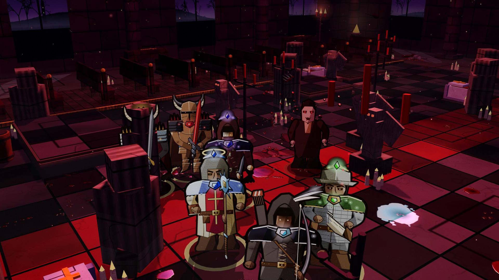

**Grim Gambit** is a dark gothic, turn-based tactics game in the style of XCOM. You lead a company of ten classes against undead, demons and vampires across haunted graveyards, burning pits, flooded crypts and ruined cathedrals.

You build your fighters out of deep talent trees, loot, set gear, runes and a forge. Gore reacts to every blow. New Game+ keeps raising the stakes, and the online Top 100 ranks every company by how far it has gone.

> **Status: Beta 0.1.5.** The game is fully playable and still growing. Updates download automatically through the launcher.

## ⬇ Download

**[Download Grim Gambit Beta 0.1.4 for Windows](https://github.com/FletcherGames/Grim-Gambit/releases/tag/beta-0.1.4)** (about 160 MB)

1. Download the `.zip` file from the Beta 0.1.4 release.
2. Extract the zip anywhere, for example `C:\Games\Grim Gambit`.
3. Run **Grim Gambit.exe**. The launcher checks for patches, then press **Play**.

Windows may show a SmartScreen warning because the game isn't code-signed yet. Click **More info → Run anyway**.

**On a phone, tablet or Mac?** [Play in your browser](https://fletchergames.github.io/play/). On a phone, turn it sideways and use **Add to Home Screen** to play fullscreen like an app. Pinch to zoom, use two fingers to pan, and press and hold on an enemy to see your hit chance.

## Features

- **Tactical battles on a grid:** every fighter gets two actions a turn on 22×20 battlefields. You work with half and full cover, high ground, overwatch, Hunker Down, stealth, ambushes and fog of war, and hover any enemy to see your exact chance to hit.
- **A battlefield that fights back:** cover cracks and collapses, barrels explode, and missed shots slam into the ground.
- **Morale and bonds:** fighters panic when things go wrong, and those who survive together form bonds that steady their nerves.
- **Objectives:** stop rituals, rescue captives, break through to the gate or hold the line.
- **Ten classes, thirty talent trees:** 30 skills per class, up to rank 20, with Diablo II–style synergies and a capstone mastery at the end of each tree. Bosses award extra skill points.
- **Loot:**
  - Affixes and item levels
  - Legendary, mythic and cursed items
  - Trophies and off-hands
  - Runes and sockets, and a forge for crafting and salvage
  - 30 matching sets, one for each talent tree
- **A campaign with New Game+:** a branching map of battles, elites, treasure and three bosses drawn at random every campaign. Each New Game+ makes it harder and the loot richer.
- **Living maps:**
  - Flowing lava in the Pit of the Damned
  - A murky swamp with hand-grown trees in the Rotting Mire
  - Rain and thunder over the Hollow Graveyard
  - A mad organist in the Black Chapel, playing along with the score
- **Gore:** fighters show wear and blood as they take damage. Wet blood splashes the floor and props, and limbs can be severed. Deaths depend on the damage type: fire, frost, poison or holy. Fallen bodies become cover, and necromancers can raise them. Gore can be set to Off, Normal or Excessive.
- **Graphics options:** windowed, fullscreen or borderless; resolution; frame-rate limit; FPS counter; brightness.
- **Guided tour:** a step-by-step walkthrough of your first campaign.
- **Cloud saves:** the game saves after every move, including mid-battle, and backs up online within seconds. Create an account to continue on any PC, or in the browser on your phone.
- **Play anywhere:** the Windows app, or right in the browser on phones, tablets and Macs, with touch controls.
- **Resume Battle:** quit in the middle of a fight and pick it up exactly where you left off.
- **Online leaderboard:** the Top 100 companies, ranked by highest New Game+ reached.

## Screenshots

| | |
|---|---|
| 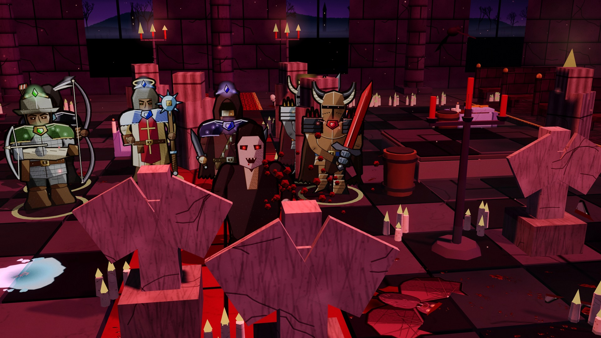 | 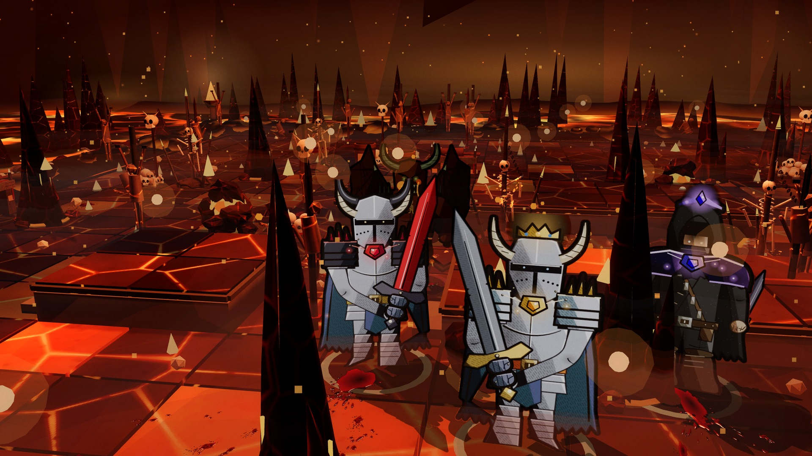 |
| 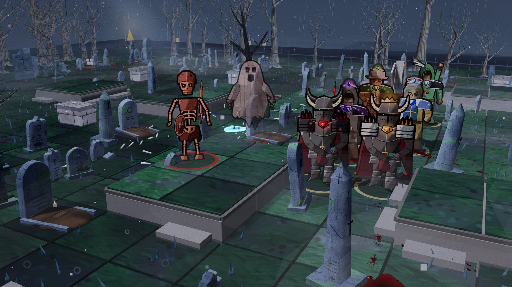 | 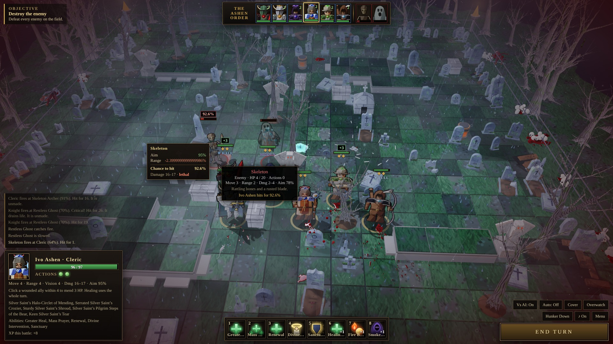 |
| 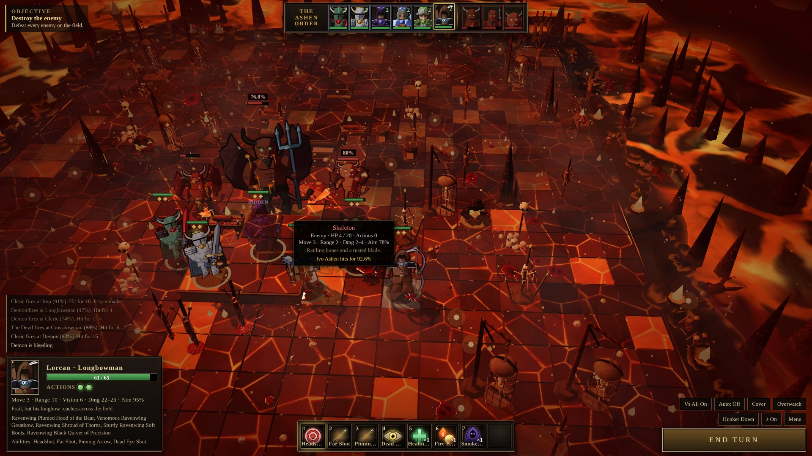 | 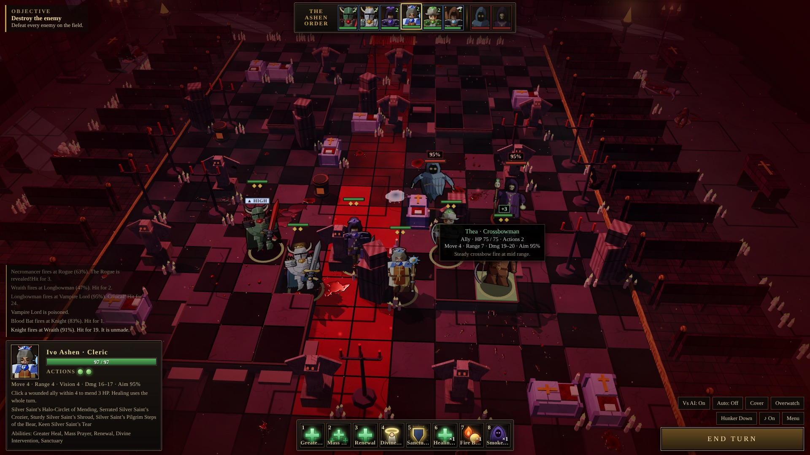 |
| 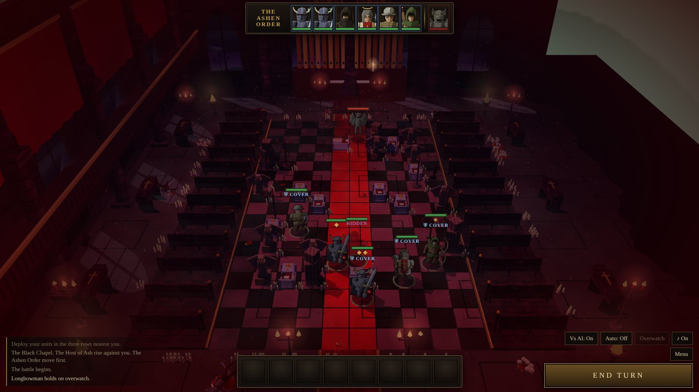 | 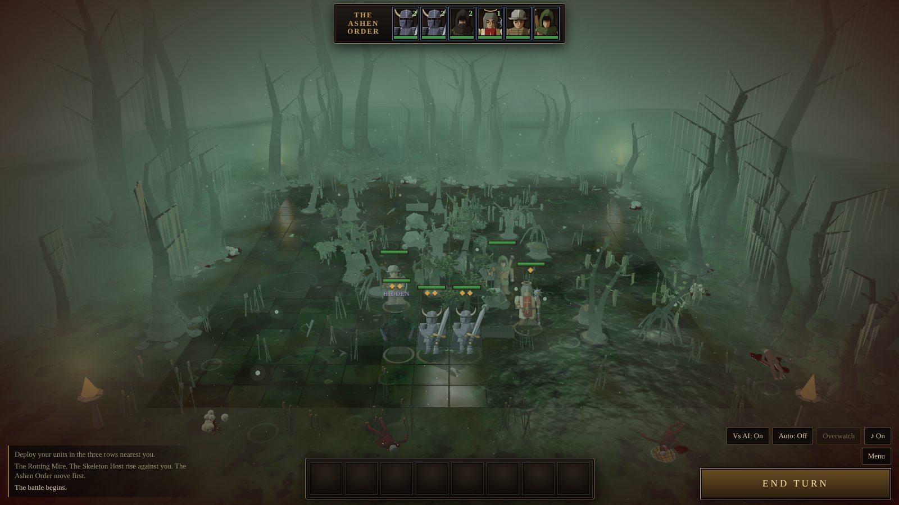 |
| 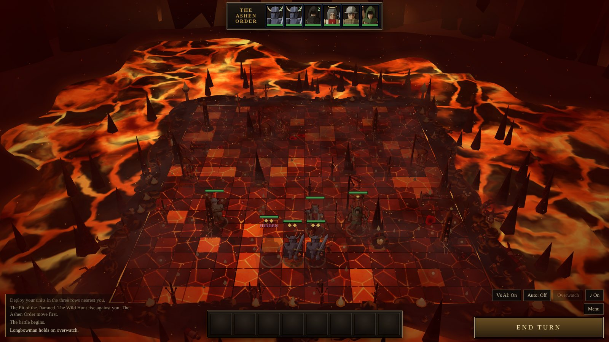 | 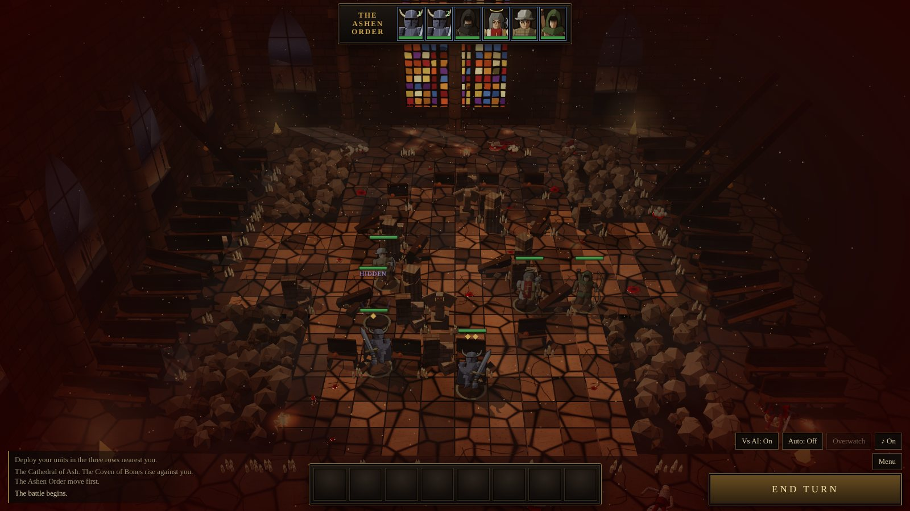 |
| 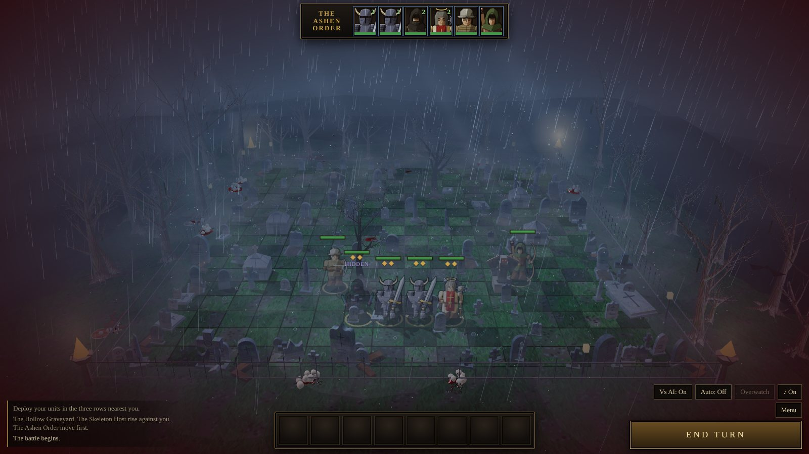 | 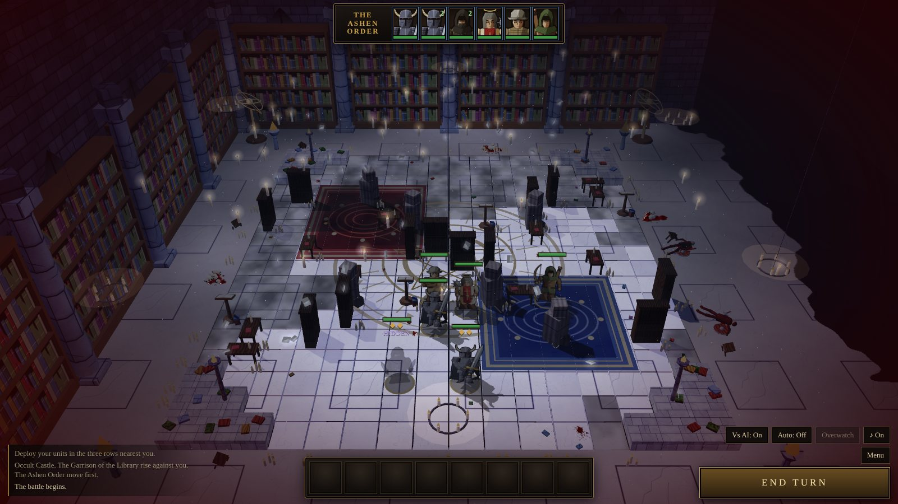 |
| 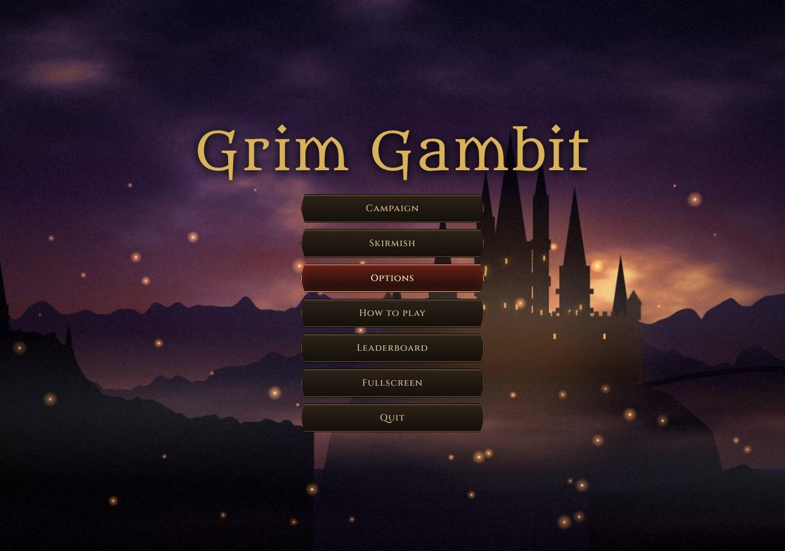 | 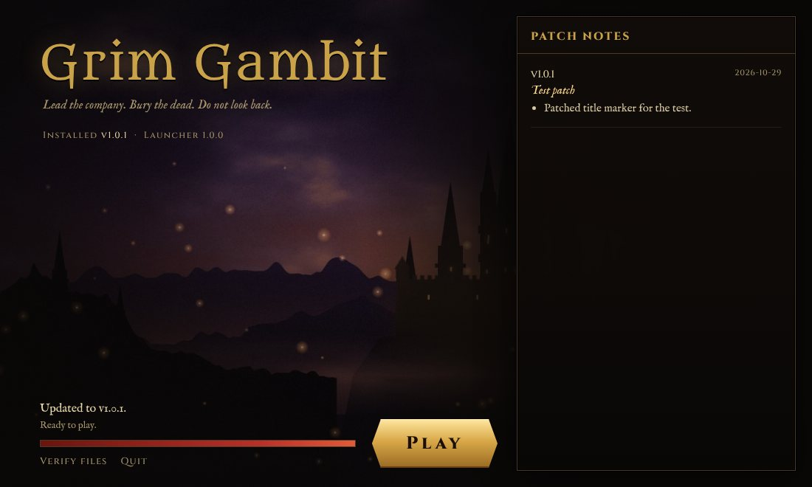 |
| 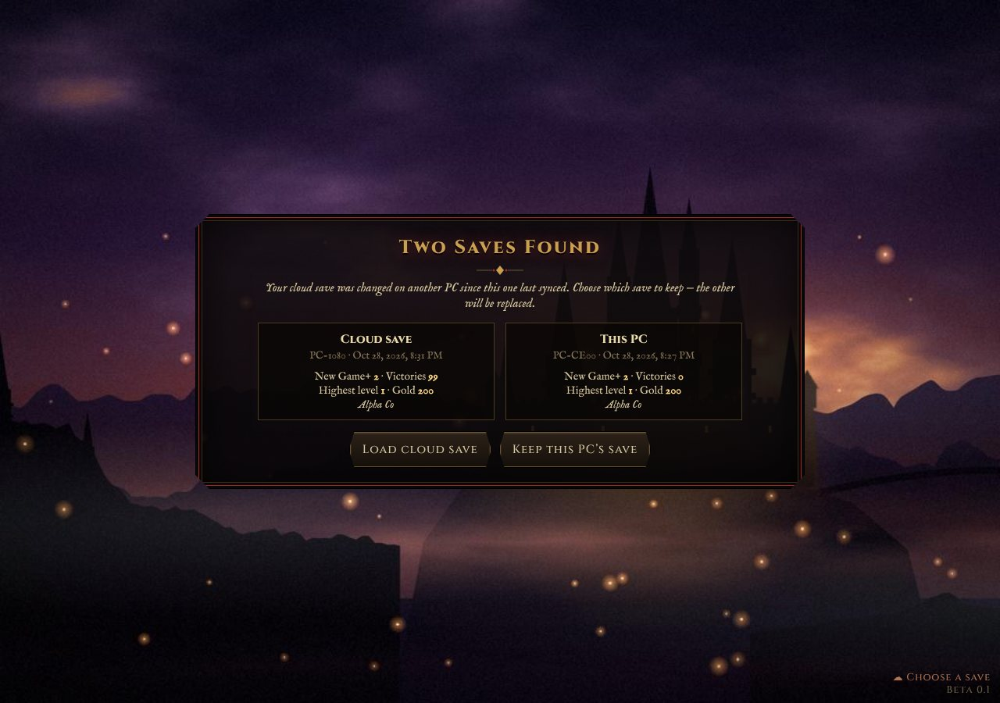 | |

## System requirements

- **OS:** Windows 10 or 11, 64-bit
- **Graphics:** any GPU with WebGL 2 support from the last decade
- **Memory:** 4 GB RAM
- **Disk:** 500 MB free
- **Internet:** optional. It's only used for patches, cloud saves and the leaderboard. Offline play works fine.

## Patch notes

### Beta 0.1.5: Smooth menus
- Fixed big stutters in the menus: the game no longer keeps drawing the last battlefield hidden behind full-screen menus like the title screen, barracks, gear and shops.
- You can always select your own fighters in battle, even on the enemy's turn or with Auto on, to see their card and ability bar. The bar is greyed out until it's their turn to act.
- Fullscreen is back on the main menu, and also in Options: one click to switch between fullscreen and windowed (F11 still works). Borderless windowed is under Options → Graphics.
- Already playing on Windows? Open the launcher and it downloads this update automatically.

### Beta 0.1.4: Blood and phones
- Big performance boost in bloody battles: blood that has finished spreading is painted into a single floor layer instead of hundreds of separate splashes, so the frame rate holds up even on Excessive gore.
- Fewer stutters when blood first appears, and blood splashing onto props is cheaper to work out.
- Grim Gambit now plays in the browser on phones and tablets, at fletchergames.github.io/play: pinch to zoom, two fingers to pan, drag to turn the camera, and press and hold on an enemy or tile to see hit chances and cover.
- Cloud saves work across the desktop game and the browser version: sign in with the same account to continue anywhere.
- Already playing on Windows? Open the launcher and it downloads this update automatically.

### Beta 0.1.3: Quiet in the ranks
- Removed the spoken voice lines and the speech bubbles over fighters. Panic, bonds and morale still work, and still show in the battle log.
- Hit chances now show as whole numbers in the battle log and the hover tooltip.
- Fixed the enemy hover card staying on screen into the next battle.
- Already playing? Open the launcher and it downloads this update automatically.

### Beta 0.1.2: Tactics of the Damned
- Bigger battlefields: every map is now 22 by 20 tiles, with room to flank, fall back and fight over objectives.
- Half and full cover: graves, crates and low walls give −20% to be hit; pillars, statues and trees give −40%. Every prop shows its shield during deployment, and you can hold C or press Cover to see them any time.
- High ground: raised stone platforms give +15% aim against targets below.
- Hit-chance preview: hover an enemy to see every modifier behind your chance to hit, plus damage and whether the shot is lethal.
- Blue and gold movement: blue tiles keep an action to attack, gold tiles are a dash that spends both. Hovering a tile shows its cover and warns of enemy overwatch.
- Hunker Down: brace behind cover for double protection until your next turn.
- Missed shots fly past the target and slam into the ground or the cover it hides behind.
- Destructible battlefield: cover cracks and collapses under fire, and volatile barrels explode.
- Morale and panic, with voice lines: losing a friend or taking a brutal hit can make a fighter flee, cower or fire wildly. Voice lines can be turned off in Options.
- Bonds: fighters who survive battles together form bonds for better aim side by side, steadier nerves, and vengeance when their partner is hurt.
- New objectives: stop the ritual, rescue the captive, break through to the gate, or hold the line, each with a turn limit and bonus gold.
- The three campaign bosses are now drawn at random from all ten every campaign, and are scaled to their place on the road. A campaign in progress re-rolls the bosses you haven't fought yet.
- New tutorials for your first battle and for returning from it, covering cover shields, high ground, objectives, barrels, Hunker Down, panic and bonds. Replay them any time from Options.
- Already playing? Open the launcher and it downloads this update automatically.

### Beta 0.1.1: Guided tour and graphics options
- New guided tour for your first campaign: step-by-step tips walk you through the map, your company and your first battle (replay it any time from Options).
- Attack is now the first button on the ability bar. Pick a target to see who you can hit, and Esc cancels aiming.
- New Graphics screen in Options: windowed, fullscreen or borderless, window size or render resolution, frame-rate limit, FPS counter and brightness.
- Cloud saves now remember your account on this PC and ask you to sign back in if your login expires, instead of starting a fresh save.
- The main menu now appears all at once when the game starts, and Fullscreen moved to Options → Graphics (F11 and Alt+Enter still work).

### Beta 0.1: The company marches
- Grim Gambit is now a desktop game with its own launcher.
- Patches download automatically when you open the launcher.
- Cloud saves: the game saves after every move on the board and every change to your company, and uploads it within seconds. Create an account under Cloud Save to continue on any PC.
- Quit in the middle of a fight and pick it up later with Resume Battle on the main menu.
- The Top 100 leaderboard is online for every player.

---

© FletcherGames. All rights reserved. Third-party libraries and fonts are listed in `THIRD_PARTY_LICENSES.txt` inside the download.
